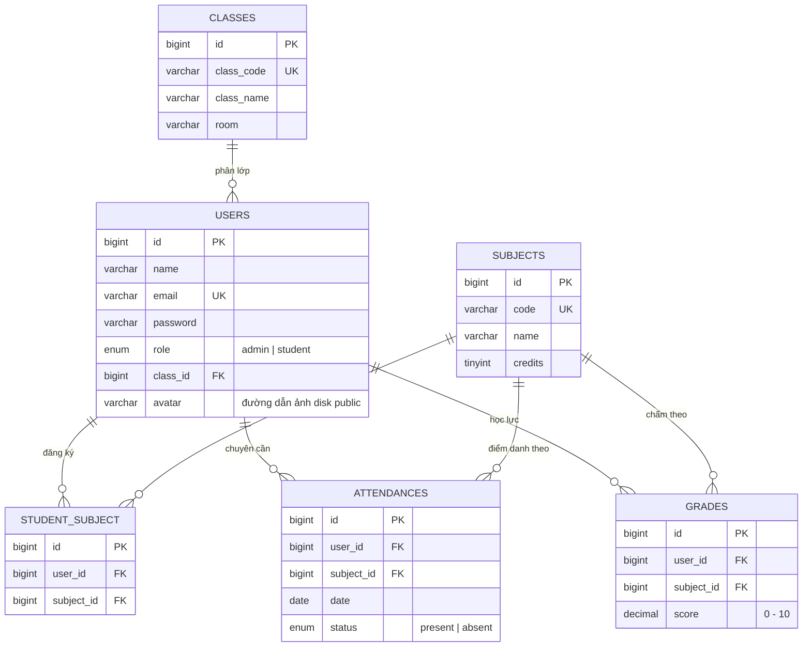
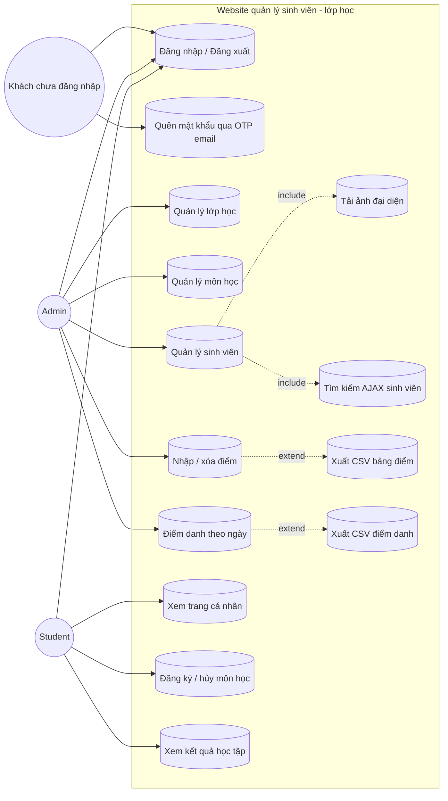

# Báo cáo đồ án: Website quản lý sinh viên - lớp học

## 1. Giới thiệu đề tài

Đề tài xây dựng một website nhỏ hỗ trợ quản lý lớp học, môn học và sinh viên. Quản trị viên theo dõi thông tin học tập, ghi nhận điểm và điểm danh; sinh viên đăng ký môn học và tự xem kết quả của mình.

### Mục tiêu

- Áp dụng Laravel, mô hình MVC, Blade Template và Eloquent ORM.
- Thiết kế cơ sở dữ liệu quan hệ trên MySQL bằng Eloquent ORM, Migration và Seeder.
- Phân quyền hai vai trò ở phía máy chủ.
- Thực hiện các luồng quản lý dữ liệu cơ bản với validate, thông báo và phân trang.
- Giữ giao diện dễ hiểu, sử dụng Bootstrap 5 và các thành phần tiêu chuẩn.

## 2. Công nghệ sử dụng

| Thành phần | Công nghệ |
|---|---|
| Backend | PHP 8.2+, Laravel 12 |
| Giao diện | Blade Template, Bootstrap 5 |
| Cơ sở dữ liệu | MySQL 8 (utf8mb4_unicode_ci) |
| Kiểm thử | PHPUnit thông qua `php artisan test` (database MySQL riêng `quanly_sinh_vien_test`) |
| Lưu file | Laravel Filesystem disk `public` cho ảnh đại diện |
| Gửi email | Dịch vụ Node.js + Nodemailer qua Gmail SMTP cho luồng OTP |

## 3. Thiết kế cơ sở dữ liệu

### Các bảng nghiệp vụ

| Bảng | Dữ liệu chính | Ghi chú |
|---|---|---|
| `classes` | `class_code`, `class_name`, `room` | Mỗi lớp có nhiều sinh viên; `class_code` được thêm để hiển thị mã lớp trên giao diện. |
| `users` | `name`, `email`, `password`, `role`, `class_id`, `avatar` | `role` gồm `admin` hoặc `student`; `class_id` có thể để trống; `avatar` lưu đường dẫn ảnh trên disk `public` (NULL nếu chưa tải lên). Mật khẩu được hash. |
| `subjects` | `code`, `name`, `credits` | Mã môn học duy nhất. |
| `student_subject` | `user_id`, `subject_id` | Bảng trung gian đăng ký môn; cặp sinh viên/môn học không được trùng. |
| `attendances` | `user_id`, `subject_id`, `date`, `status` | Trạng thái `present` hoặc `absent`; mỗi sinh viên có tối đa một bản ghi cho một môn trong một ngày. |
| `grades` | `user_id`, `subject_id`, `score` | Bảng bổ sung để hiện thực yêu cầu xem điểm; điểm hợp lệ từ 0 đến 10, mỗi sinh viên/môn học có một điểm hiện tại. |

Laravel đồng thời sử dụng các bảng hỗ trợ mặc định như `sessions`, `cache`, `jobs` và `password_reset_tokens`.

### Quan hệ

- `classes` 1 - N `users`: một lớp có nhiều sinh viên; sinh viên có thể chưa được xếp lớp.
- `users` N - N `subjects`: thông qua `student_subject`.
- `users` 1 - N `attendances`; `subjects` 1 - N `attendances`.
- `users` 1 - N `grades`; `subjects` 1 - N `grades`.
- Khóa ngoại nghiệp vụ dùng xóa dây chuyền. Khi xóa lớp trên giao diện, ứng dụng chuyển sinh viên về trạng thái chưa xếp lớp trước để không xóa tài khoản.

### Sơ đồ ERD



Ràng buộc duy nhất: `student_subject (user_id, subject_id)`, `attendances (user_id, subject_id, date)`, `grades (user_id, subject_id)`.

## 4. Chức năng theo vai trò

### Admin

- Đăng nhập và truy cập trang quản trị.
- Thêm, sửa, xóa, tìm kiếm và phân trang lớp học.
- Quản lý môn học và sinh viên; tải ảnh đại diện cho sinh viên (JPG/PNG/WebP, tối đa 2 MB).
- Danh sách sinh viên tìm kiếm theo tên hoặc email bằng AJAX, kết quả cập nhật ngay không tải lại trang.
- Nhập/cập nhật điểm cho sinh viên đã đăng ký môn học; điểm được kiểm tra trong khoảng 0-10.
- Điểm danh các môn sinh viên đã đăng ký theo ngày và xem tổng số có mặt/vắng.
- Xuất bảng điểm và bảng điểm danh của một ngày ra file CSV.

### Student

- Đăng nhập vào trang sinh viên.
- Xem môn học đang mở, đăng ký môn và hủy môn đã đăng ký.
- Không thể đăng ký cùng một môn hai lần.
- Chỉ xem điểm thuộc tài khoản của mình.

### Sơ đồ UML Use Case



## 5. Yêu cầu mở rộng đã hiện thực

| Nhóm yêu cầu | Phạm vi đã làm | Kỹ thuật |
|---|---|---|
| Upload file | Admin tải ảnh đại diện cho sinh viên khi thêm hoặc sửa; ảnh mới thay thế và tự xóa file cũ; ảnh hiển thị ở danh sách sinh viên, thanh bên và menu tài khoản. | Validation `File::image()->types([jpg,png,webp])->max(2MB)`, lưu disk `public` qua `php artisan storage:link`, cột `users.avatar`. |
| Tích hợp AJAX | Ô tìm kiếm ở danh sách sinh viên tự truy vấn sau 350 ms ngừng gõ, chỉ thay vùng bảng và phân trang, không tải lại trang; địa chỉ trình duyệt vẫn cập nhật để chia sẻ/link lại được. | `fetch()` kèm header `X-Requested-With`, controller trả `rows`/`pagination`/`total` dạng JSON khi `expectsJson()`, `AbortController` hủy request cũ, giữ nguyên submit thường khi tắt JavaScript. |
| API / dịch vụ bên ngoài | Đặt lại mật khẩu bằng mã OTP 6 số gửi qua Gmail SMTP (dịch vụ Nodemailer riêng chạy trên `127.0.0.1:3001`, Laravel ký HMAC trước khi gửi). Xuất báo cáo CSV mở trực tiếp bằng Excel. | Luồng OTP có hạn 15 phút, tối đa 5 lần nhập sai, cooldown 60 giây; CSV dùng UTF-8 BOM và phân cách TAB để tiếng Việt và số thập phân hiển thị đúng. |
| Responsive | Layout Spark Admin dùng sidebar dạng offcanvas trên màn hẹp, nút "Mở thanh điều hướng", các bảng nằm trong `.table-responsive`, form theo lưới Bootstrap. | Bootstrap 5 grid + breakpoint `xl`. |

### Hạn chế ghi nhận

- Collation `utf8mb4_unicode_ci` của MySQL không phân biệt dấu, nên tìm `thu` cũng ra "Thu Hà" và "Thư". Đây là hành vi chuẩn của MySQL; muốn tìm đúng dấu phải đổi cột sang `utf8mb4_0900_as_cs` hoặc chuẩn hóa chuỗi không dấu khi lưu.
- Ảnh đại diện lưu trên đĩa của máy chủ, chưa có bước đổi kích thước; môi trường nhiều node cần lưu trữ tập trung (S3/NFS).
- Xuất báo cáo mới ở dạng CSV, chưa có mẫu PDF/In.

## 6. Phân công nhóm 4 người

| Thành viên | Phần việc |
|---|---|
| Trưởng nhóm | Thiết kế cơ sở dữ liệu, đăng nhập/phân quyền, quản lý Git và tích hợp các phần. |
| Thành viên 2 | CRUD lớp học, CRUD môn học và giao diện quản trị. |
| Thành viên 3 | Quản lý sinh viên (gồm tải ảnh đại diện), tìm kiếm AJAX, đăng ký/hủy môn học và giao diện sinh viên. |
| Thành viên 4 | Điểm danh, quản lý điểm, xuất báo cáo CSV, kiểm thử và hoàn thiện tài liệu. |

## 7. Hướng dẫn chạy nhanh trên máy local

Yêu cầu PHP 8.2 trở lên, Composer, extension `pdo_mysql` và một MySQL 8 server đang chạy (Laragon/XAMPP). Tạo sẵn hai cơ sở dữ liệu, một cho ứng dụng và một cho bộ kiểm thử:

```powershell
mysql -u root -e "CREATE DATABASE quanly_sinh_vien CHARACTER SET utf8mb4 COLLATE utf8mb4_unicode_ci; CREATE DATABASE quanly_sinh_vien_test CHARACTER SET utf8mb4 COLLATE utf8mb4_unicode_ci;"
```

```powershell
composer install
Copy-Item .env.example .env
php artisan key:generate
php artisan migrate --seed
php artisan storage:link
php artisan serve
```

`storage:link` tạo nối tắt `public/storage` để trình duyệt đọc được ảnh đại diện đã tải lên (mặc định Laravel đã bỏ sẵn `/public/storage` vào `.gitignore`).

Thông số kết nối nằm trong `.env` (`DB_CONNECTION=mysql`, `DB_HOST=127.0.0.1`, `DB_PORT=3306`, `DB_DATABASE=quanly_sinh_vien`, `DB_USERNAME=root`, `DB_PASSWORD=`). Toàn bộ schema do Migration tạo, không can thiệp tay vào phpMyAdmin.

Truy cập `http://127.0.0.1:8000`. Tài khoản admin mẫu là `admin@gmail.com`, mật khẩu `12345678`; mật khẩu của năm tài khoản sinh viên mẫu cũng là `12345678`.

Khi triển khai ra Internet, cần cấu hình HTTPS, `APP_DEBUG=false` và cookie phiên `SESSION_SECURE_COOKIE=true`; tài khoản mẫu chỉ dùng để trình diễn local.

Chạy kiểm thử (PHPUnit dùng database `quanly_sinh_vien_test` khai báo trong `phpunit.xml`, tự dựng lại bảng qua `RefreshDatabase`):

```powershell
php artisan test
```
